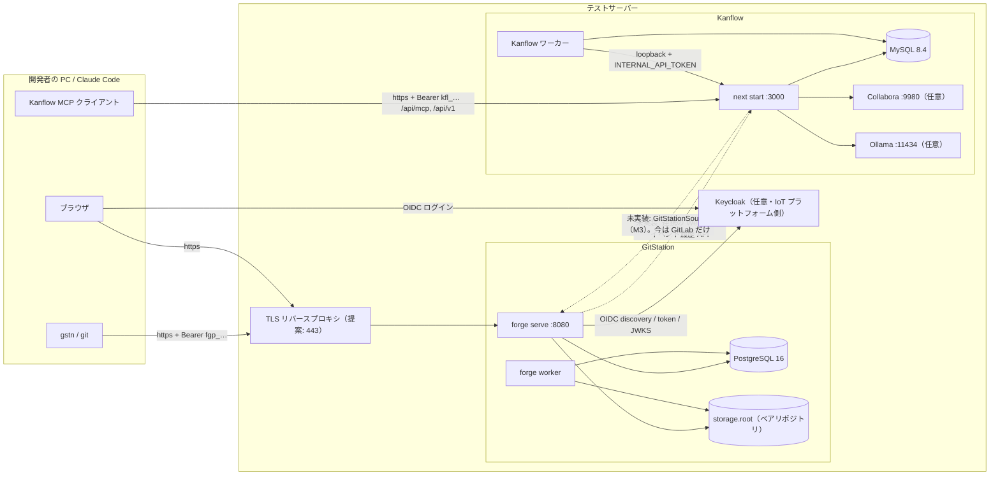

# GitStation と Kanflow のテストサーバー構築ガイド

対象: オンプレの**テストサーバー**に、GitStation と Kanflow の現時点のテスト版を入れ、つなぎ、動作を確かめる。
**本番の変更は範囲外**（CLAUDE.md 契約 7）。この文書だけを読んで、人でも新しい Claude のセッションでも作業できるように書いた。

- 作成: 2026-11-01（リポジトリの調査に基づく）。記載のコマンド・設定は、すべて出典のファイルを `(出典: パス)` で示した。
- 出典のないものは **「未確認」** と明記した。推測で補った箇所は **「提案」** と書いた（リポジトリに根拠はない）。
- 秘密・実ホスト名・実 IP・個人のメールは書かない。`<TEST_SERVER_HOST>`、`<DB_PASSWORD>` のような**置き換える印**を使う。
  リポジトリにコミット済みの合成の開発用資格情報は、パスだけを示し、値は写さない。
- 推奨の読み方: §0 → §1 → §2 → §3（GitStation）→ §4（Kanflow）→ §5（連携）→ §6（確認）。§8 は先に目を通すと手戻りが減る。

---

## 0. 先に知っておくこと（結論）

| 項目 | 内容 |
|---|---|
| GitStation | Rust 製の 2 プロセス構成（`forge serve` と `forge worker`）＋ PostgreSQL 16。ブラウザの画面（SPA）は `embed-ui` で `forge` に埋め込める。**TLS は持たない**（リバースプロキシの仕事）。 |
| Kanflow | Next.js 16 / Prisma 7 / MySQL 8.4。本番は Windows 11 の常駐サービス構成。ワーカー（翻訳・AI 監視）は別プロセス。Collabora と Ollama は任意。 |
| **連携の現状** | **GitStation↔Kanflow の機械的な連携（Webhook、イベント履歴 API、`GitStationSource`）は、どちらのリポジトリにもまだ無い**（§5.1）。明日つなげるのは「同じ利用者が Claude Code から `gstn`（GitStation）と Kanflow MCP の両方を使う」形と、ブランチ名の PBI 番号の規約まで。 |
| 画面 | GitStation の UI は基礎（殻・ログイン）まで。ホーム・リポジトリ閲覧・設定の画面（MR9〜MR12）は**未実装**（§7）。日常の操作は `gstn` と API で行う。 |
| ブラウザのログイン | OIDC（Keycloak）だけ。**Keycloak 無しだと画面から入れない**（`gstn` とトークンは使える）。Keycloak は IoT プラットフォーム側が用意する想定（§3.9）。 |
| 実機の検証 | GitHub の CI は一度も動いていない。Keycloak の E2E、Kanflow の実 MySQL のテストと E2E も**未実行**（§7）。つまり**初めての実機**であり、手順どおりに進まない箇所が出る前提で、§8 の runbook を手元に置く。 |

---

## 1. 全体像

### 1.1 構成要素

| 要素 | 役割 | 既定のポート | 備考・出典 |
|---|---|---|---|
| GitStation `forge serve` | HTTP サーバー（REST API v1、Smart HTTP の git、埋め込み UI） | 127.0.0.1:8080 | `server.bind` の既定。非ループバックで待ち受けると「TLS のリバースプロキシを前に置け」の警告が出る (出典: `crates/forge-core/src/config.rs` の `build`、`crates/forge-web/src/server.rs`) |
| GitStation `forge worker` | 背景タスク（リポジトリの作成、アウトボックスの採番、監査の封印、削除の確定）。**動いていないとプロジェクトを作ってもリポジトリができない** | なし | (出典: `crates/forge-cli/src/worker/mod.rs`、`ops/runbooks/repository-provisioning.md`) |
| GitStation の埋め込み UI | `/` 以下の殻と `/-/assets/` | `forge serve` と同じ | (出典: `web/README.md`、`docs/adr/0022-web-ui-foundation-react-typescript-embedded.md` §2) |
| PostgreSQL 16 | GitStation の DB（`forge`） | 5432（本番想定）。開発用 compose は 127.0.0.1:55432 | 16 未満は拒否 (出典: `crates/forge-db/src/options.rs` の `MIN_SERVER_VERSION_NUM`) |
| Keycloak（任意） | ブラウザの OIDC ログイン | 開発用 compose は 127.0.0.1:58080 | (出典: `ops/dev/compose.yml`、`docs/adr/0021-oidc-keycloak-login-and-web-sessions.md` §13) |
| `gstn` | GitStation のクライアント CLI（開発者の PC / Claude Code が使う） | — | `forge-client` は `forge-errors` だけに依存 (出典: `crates/forge-client/README.md`) |
| Kanflow（Next.js） | PM ツール本体 + REST API v1 + MCP サーバー（`/api/mcp`） | 3000 | (出典: `Kanflow/README.md` の技術スタック表) |
| Kanflow ワーカー | 翻訳キュー・AI 監視・AI ジョブ | なし | (出典: `Kanflow/docs/operations/worker.md`) |
| MySQL 8.4 | Kanflow の DB（`scrum_tool`） | 3306 | (出典: `Kanflow/README.md`) |
| Collabora Online（任意） | Office 文書のブラウザ編集（WOPI） | 9980 | (出典: `Kanflow/docker-compose-collabora.yml`) |
| Ollama（任意） | Kanflow のローカル AI | 11434 | 既定モデルなど (出典: `Kanflow/app/.env.example`) |

### 1.2 つながり方



点線は**まだ無い**経路（§5.1）。

### 1.3 デプロイするブランチとコミット

| リポジトリ | ブランチ | コミット | 出典 |
|---|---|---|---|
| GitStation | `claude/brave-cray-w62c35` | `8649cc65dc57b0708913c5d0e44c6f0a53728871`（M2 の MR1〜MR5・MR7・MR8 を統合） | `git log -1` で確認（この文書の作成時） |
| Kanflow | `claude/brave-cray-w62c35` | `23db573f14552f609ebae3270b1cde063fbf98a9`（PBI の機密フラグ D-5 まで） | 同上 |

- GitStation の `main` はこのブランチの祖先（`8fea414`）で古い。**ブランチ `claude/brave-cray-w62c35` の先端を使う**。
  MR5（ログアウト・リフレッシュ）は**含まれる**。MR6（UI 支援 API）は**含まれない**（作業中）(出典: `git log`、`docs/plan/10-m2-plan.md` §6)。
- 取得元: 両リポジトリとも `origin` は GitHub の私設リポジトリ（`git remote -v`）。**テストサーバーから GitHub に届くか、社内ミラーが要るかは「未確認」**。届かないなら、PC で `git bundle` を作って持ち込む（提案）。
- 作業の前にコミットを固定する: `git checkout --detach <上の SHA>`（提案。再現性のため）。

---

## 2. サーバーの前提

### 2.1 OS とツール

| 項目 | GitStation | Kanflow | 出典 |
|---|---|---|---|
| OS | 本番は **Linux**（Windows は開発機）。テストサーバーの OS は**未確認** | 本番は **Windows 11**（サービス・watchdog・バックアップは PowerShell）。Linux でも `next build` / `next start` / vitest / Playwright は CI で動かしている（実運用の常駐化は未確認） | `docs/adr/0013-configuration-layers-and-secret-files.md`、`Kanflow/README.md`、`Kanflow/docs/ci.md` |
| Rust | `rust-toolchain.toml` の `channel = "1.99.1"`（components: clippy, rustfmt, profile minimal）。`Cargo.toml` の `rust-version = "1.88"` | — | `rust-toolchain.toml`、`Cargo.toml` |
| Node | `web/` のビルドに **22 以上**（`engines`） | 本番サーバーは **v25**、CI も 25。`package.json` に `engines`、`.nvmrc` は**無い** | `web/package.json`、`Kanflow/README.md`、`Kanflow/docs/ci.md` |
| git | **2.38 以上**（`forge` が起動時に確認。足りなければ `FG-GIT-0001`）。`git` は `PATH` から実行される | 不要（Git 連携は GitLab の API を呼ぶだけ） | `crates/forge-git/src/version.rs`、`crates/forge-cli/src/serve.rs` |
| DB | PostgreSQL **16 以上**（superuser でロールと DB を作る） | MySQL **8.4**（utf8mb4 / utf8mb4_unicode_ci） | `ops/runbooks/db-bootstrap.md`、`Kanflow/.github/workflows/ci.yml`、`Kanflow/docs/operations/backup-restore.md` |
| コンテナ | テストの DB 用に Docker（`ops/dev/compose.yml`）。本番の DB はコンテナ前提ではない | Collabora 用（`docker-compose-collabora.yml`）。Dockerfile もあるが旧構成（`legacy/`） | 同左 |
| ビルド依存 | 追加の OS パッケージ（C コンパイラ・pkg-config 等）の要否は**未確認**。`gstn` は libdbus を静的に同梱 (`vendored`) | `npm ci` に必要なネイティブビルドの要否は**未確認** | `crates/forge-client/Cargo.toml` |
| パッケージ取得 | crates.io / npm レジストリにテストサーバーから届くかは**未確認**。Kanflow の社内ネットワークでは `registry.npmjs.org` が遮断されており `https://registry.yarnpkg.com/` を使う | 同左 | `Kanflow/README.md`、`Kanflow/.gitlab-ci.yml` |

届かない場合の逃げ道（提案）: ビルド機で GitStation のバイナリ（`forge`、`gstn`）と Kanflow の `app/.next` と `node_modules` を作り、サーバーへ持ち込む。
ただし Kanflow のデプロイ手順は「`node_modules` の入れ替えはデプロイ手順だけが行う」前提（`Kanflow/setup/install-kanflow-service.bat` のコメント）なので、持ち込む場合も同じ OS・同じ Node の版でそろえること。

### 2.2 ディスクとメモリ

- 具体的な必要量は**未確認**（リポジトリに基準値が無い）。分かっている事実:
  - GitStation のテストの実行は DB のテストバイナリで大きくディスクを使う。MR4・MR8 の作業でディスクが逼迫した（空き 0.9 GB まで）という記録がある (出典: `docs/handoff/2026-11-01-m2-mr4.md` §1・§5、`docs/handoff/2026-11-01-m2-mr8.md` §5)。**`cargo build` / `cargo nextest` を同じサーバーで走らせるなら、`target/` に数 GB 以上の空きを見込む**（提案）。
  - 全体テストは約 600 件・7〜14 分、2 つ同時に走らせない（Postgres が落ちた実績）(出典: `CLAUDE.md` の Gates)。
  - git の push 上限の既定は 2 GiB（`git.http.push_max_bytes`）(出典: `crates/forge-core/src/config/git_http.rs`)。リポジトリの置き場（`storage.root`）はそれを見込む。
  - Kanflow の添付は 1 プロジェクト 5 GB まで（`ATTACHMENT_PROJECT_QUOTA_MB`）(出典: `Kanflow/app/.env.example`)。
- 時刻: サーバーの時計がずれていると OIDC が失敗する（60 秒超でエラー）(出典: `ops/runbooks/oidc-login.md`)。NTP を合わせる。

### 2.3 ネットワークと名前

- **HTTPS が事実上必須**（§3.7）。GitStation の `web.base_url` は `https://` か `http://localhost`/`127.0.0.1`/`[::1]` のみ。`gstn` も `http://` は localhost だけ。Kanflow の MCP セットアップスクリプトも `https://` 必須（`localhost` 以外の `http` は `--allow-http` で警告付き）。
  (出典: `crates/forge-core/src/config/web.rs`、`crates/forge-client/README.md`、`Kanflow/docs/mcp-setup-guide.md`)
- 社内 CA の証明書とホスト名は**未確認**（`<TEST_SERVER_HOST>` に置き換える）。GitStation の DB の TLS と OIDC の https は社内 CA の PEM を渡す（公開 CA は信頼しない設計）。
- 公開してよいポートは、リバースプロキシ（443）だけにし、8080 / 3000 / 9980 / 3306 / 5432 はループバックか内部に閉じる（提案。GitStation は `FG-SYS-0004` の runbook で「1024 未満のポートは使わずプロキシから転送」を勧めている: `ops/runbooks/server-start-failed.md`）。

---

## 3. GitStation

作業ディレクトリはリポジトリのルート（`/home/user/GitStation` に相当。サーバー上のパスは `<GITSTATION_SRC>` とする）。

### 3.1 ビルド

```bash
cd <GITSTATION_SRC>
git checkout --detach 8649cc65dc57b0708913c5d0e44c6f0a53728871   # 提案: 固定

# (a) 画面 (SPA) — 先にビルドする。build.rs は web/dist が無いと失敗する
cd web
npm ci --ignore-scripts          # (出典: web/README.md)
npm run build                    # dist/ と .br/.gz を作る (出典: web/package.json の scripts)
cd ..

# (b) サーバー: UI を埋め込んだリリースビルド (出典: web/README.md、crates/forge-cli/Cargo.toml の features)
cargo build --release -p forge-cli --features embed-ui

# (c) クライアント gstn (出典: crates/forge-client/Cargo.toml の [[bin]])
cargo build --release -p forge-client
```

- 成果物: `target/release/forge`、`target/release/gstn`。
- `embed-ui` を付けないと殻は**プレースホルダー**で、`forge doctor` が `web.ui` を警告する (出典: `crates/forge-cli/Cargo.toml`)。付けたときは `web.ui` が `embedded` になる (出典: `docs/ci.md` の release build ジョブ)。
- `cargo build` は `rust-toolchain.toml` により rustup が指定の版を取りに行く。オフラインなら事前にその版を入れておく（提案）。
- `web/dist` に許可外の拡張子やサブディレクトリがあるとビルドが失敗する (出典: `crates/forge-web/build.rs`)。

### 3.2 PostgreSQL のロールと DB の導入（bootstrap）

出典: `ops/runbooks/db-bootstrap.md`（手順の正）、`ops/db/bootstrap/01-cluster-roles.sql` / `02-create-database.sql` / `03-database-objects.sql`。

**superuser で**、順に実行する。各ファイルは最初の誤りで止まる。手で `psql` を開いたら最初に `SET search_path = pg_catalog, pg_temp;`。

```bash
cd <GITSTATION_SRC>/ops/db/bootstrap

# 1. クラスターのロール（forge_owner, forge_migrator, forge_seq, forge_purge, forge_app, forge_ro, forge_maint, forge_audit の 8 つ）
psql -d postgres -f 01-cluster-roles.sql

# 2. ログイン 3 つのパスワード（\password は入力を表示しない。値は記録に残さない）
psql -d postgres -c '\password forge_app'
psql -d postgres -c '\password forge_migrator'
psql -d postgres -c '\password forge_maint'

# 3. DB を作る（新規のみ。DB の所有者はこの superuser になる）
psql -d postgres -v dbname=forge -f 02-create-database.sql

# 4. DB の中のオブジェクト（1 トランザクション。何度でも実行可）
psql -d forge -f 03-database-objects.sql
```

- LOGIN できるのは `forge_migrator`・`forge_app`・`forge_maint` の 3 つだけ。`rolsuper` はすべて false (出典: 同 runbook の Diagnose 3)。
- `<DB_PASSWORD>` は 3 つとも別の値にし、手順書・チャット・リポジトリに書かない。
- PostgreSQL の TLS: 既定は `verify-full`（サーバー証明書が社内 CA で検証できること）。DB を同じホストのループバックに置くなら `database.tls_mode = "disable"` を使える。非ループバックで `require` / `disable` を使うには `database.tls_allow_unverified = true` が要る (出典: `docs/adr/0013-configuration-layers-and-secret-files.md`)。
- 確認: `psql -d forge -c "SELECT bootstrap_version, applied_at FROM forge_audit.bootstrap_log ORDER BY id;"`（`forge_app` で読める）(出典: 同 runbook)。

### 3.3 秘密ファイル

秘密は**ファイルで**渡す。絶対パス、所有者だけが読める（`0600`）、Unix では他人が読めると拒否される (出典: `crates/forge-core/src/config/secret.rs`)。
置き場は `<SECRETS_DIR>`（例: `/etc/forge/secrets`、提案）。`forge serve` のサービスユーザーは**移行と保守のパスワードのファイルを読めないようにする** (出典: `ops/runbooks/db-bootstrap.md` 手順 5)。

| ファイル | 中身・形式 | 使うキー | 出典 |
|---|---|---|---|
| `<SECRETS_DIR>/db-app.pw` | `forge_app` のパスワード（1 行。末尾の改行は無視） | `database.password_file` | `crates/forge-core/src/config/secret.rs` |
| `<SECRETS_DIR>/db-migrate.pw` | `forge_migrator` のパスワード | `database.migrate_password_file` | 同上 |
| `<SECRETS_DIR>/db-maint.pw` | `forge_maint` のパスワード（現行の `forge admin` は使わない。§3.7 の注） | `database.maint_password_file` | 同上 |
| `<SECRETS_DIR>/cursor-keys` | 1 行 1 鍵 `<kid> <64桁の16進>`。kid は 1〜65535、鍵は 32 バイト。`#` 行・空行は無視 | `api.cursor_keys_file`（**serve に必須**） | `crates/forge-core/src/config/api.rs` |
| `<SECRETS_DIR>/audit-seal-keys` | 1 行 1 鍵 `<key_id> <16進>`。key_id は 1〜32767、鍵は 32〜64 バイト | `audit.seal_keys_file`（**worker に必須**） | `crates/forge-core/src/config/audit.rs` |
| `<SECRETS_DIR>/web-session-keys` | `cursor-keys` と同じ形式（kid 1〜65535、32 バイト） | `web.session_key_file`（OIDC を使うなら**必須**） | `crates/forge-core/src/web_keys.rs` |
| `<SECRETS_DIR>/oidc-client-secret` | Keycloak のクライアントの秘密（1 行） | `auth.oidc.client_secret_file` | `crates/forge-core/src/config/auth.rs` |

鍵の生成例（**提案**。形式はここの出典どおり）:

```bash
umask 077
printf '1 %s\n' "$(openssl rand -hex 32)" > <SECRETS_DIR>/cursor-keys
printf '1 %s\n' "$(openssl rand -hex 32)" > <SECRETS_DIR>/audit-seal-keys
printf '1 %s\n' "$(openssl rand -hex 32)" > <SECRETS_DIR>/web-session-keys
```

- 監査の封印の鍵は「足すだけ・消さない」（古い鍵は古い封印の検証に要る）(出典: `crates/forge-core/src/config/audit.rs`)。
- `forge serve` と `forge worker` が複数プロセスなら `web.session_key_file` は**同じ内容**にする（違うと FG-AUTH-0011 `state_cookie_invalid`）(出典: `ops/runbooks/oidc-login.md`)。

### 3.4 設定（ファイル・環境変数）

- 層（低い順）: 組み込みの既定値 → TOML（`--config <path>` または `FORGE_CONFIG`）→ 環境変数 → コマンドラインのフラグ (出典: `crates/forge-core/src/config.rs`)。
- 環境変数名は `FORGE_<セクション>_<キー>`（`database.url` → `FORGE_DATABASE_URL`）。**未知のキー・つづりの誤り・空の値・旧名（`FORGE_BIND`、`FORGE_DATABASE_MAX_CONNECTIONS`）はすべて起動失敗（FG-SYS-0002）**。
- DB の URL は `postgres://user@host[:port]/dbname` だけ。**パスワード・クエリを URL に書くと拒否**。`~/.pgpass` と `PGPASSWORD` 等の libpq 変数は拒否（`libpq_env`）(出典: ADR-0013)。
- **ログインごとに別の設定ファイル**にする。`forge serve` は移行・保守のパスワードのファイルがある設定では起動しない（`reason=not_for_this_command`）(出典: `ops/runbooks/db-bootstrap.md` 手順 5、`crates/forge-core/src/config/database.rs`)。

#### 3.4.1 `serve` / `worker` / `doctor` / `admin` 用の設定（`<CONF_DIR>/forge.toml`）

```toml
# 出典: crates/forge-core/src/config/keys.rs（キーの全一覧）。値は置き換える印。
[server]
bind = "127.0.0.1:8080"                  # プロキシの転送先。既定も 127.0.0.1:8080
# プロキシ経由だと接続元が全員プロキシになる。上げる (§3.7)
max_connections_per_peer = 512           # 既定 64。max_connections (既定 1024) 以下

[storage]
root = "<STORAGE_ROOT>"                  # 例: /srv/forge/storage  (serve/worker に必須。git の HOME もここに固定される)

[database]
url = "postgres://forge_app@<DB_HOST>:5432/forge"
password_file = "<SECRETS_DIR>/db-app.pw"
tls_mode = "verify-full"                 # 既定。同一ホストのループバックなら "disable" 可
tls_root_cert = "<INTERNAL_CA_PEM>"      # 社内 CA (絶対パス)。verify-full のとき

[api]
cursor_keys_file = "<SECRETS_DIR>/cursor-keys"   # serve に必須

[audit]
seal_keys_file = "<SECRETS_DIR>/audit-seal-keys" # worker に必須

[web]
base_url = "https://<TEST_SERVER_HOST>"          # serve に必須。パス・クエリ・ユーザー情報なし
session_key_file = "<SECRETS_DIR>/web-session-keys"

# --- Keycloak を使うときだけ。ひとまとまり (全部なし or 必須が全部) ---
[auth.oidc]
issuer = "https://<KEYCLOAK_HOST>/realms/<REALM>"
client_id = "gitstation"
client_secret_file = "<SECRETS_DIR>/oidc-client-secret"
ca_file = "<INTERNAL_CA_PEM>"            # issuer が https なら必須、http なら指定不可
# employee_number_claim = "employee_number"   # 既定
# access_role = "access"                      # 既定
# signing_algs = "RS256"                      # 既定 (RS256, ES256 のみ)
# auto_link = true                            # 既定。§3.9 の条件を満たせないなら false
```

#### 3.4.2 `db migrate` 用の設定（`<CONF_DIR>/forge-migrate.toml`）

```toml
[database]
migrate_url = "postgres://forge_migrator@<DB_HOST>:5432/forge"
migrate_password_file = "<SECRETS_DIR>/db-migrate.pw"
tls_mode = "verify-full"
tls_root_cert = "<INTERNAL_CA_PEM>"
```

`forge db migrate` は `database.migrate_url` と `migrate_password_file` を使う（`database.url` は不要）(出典: `crates/forge-db/src/migrator.rs` の `connect_migrator`)。

#### 3.4.3 キー一覧（既定値・必須）

出典: `crates/forge-core/src/config/keys.rs`（名前）、`config.rs` / `config/*.rs`（既定値と制約）。

| キー | 環境変数 | 意味 | 必須？ | 既定 / 例 |
|---|---|---|---|---|
| `server.bind` | `FORGE_SERVER_BIND` | 待ち受け `host:port`（`--bind` で上書き可） | 任意 | `127.0.0.1:8080` |
| `server.max_connections` | `FORGE_SERVER_MAX_CONNECTIONS` | 全体の同時接続 | 任意 | 1024 |
| `server.max_connections_per_peer` | `FORGE_SERVER_MAX_CONNECTIONS_PER_PEER` | 接続元ごと（IPv6 は /64）。`max_connections` 以下 | 任意 | 64 |
| `server.header_read_timeout_ms` | `FORGE_SERVER_HEADER_READ_TIMEOUT_MS` | ヘッダ読みの上限 | 任意 | 30000 |
| `server.keep_alive_max_ms` | `FORGE_SERVER_KEEP_ALIVE_MAX_MS` | keep-alive の寿命 | 任意 | 600000 |
| `server.keep_alive_max_requests` | `FORGE_SERVER_KEEP_ALIVE_MAX_REQUESTS` | 1 接続の要求数 | 任意 | 1000 |
| `server.write_idle_timeout_ms` | `FORGE_SERVER_WRITE_IDLE_TIMEOUT_MS` | 書き込みの無通信 | 任意 | 60000 |
| `server.read_idle_timeout_ms` | `FORGE_SERVER_READ_IDLE_TIMEOUT_MS` | 本文読みの無通信。`git.http.idle_timeout_ms` 以上 | 任意 | 60000 |
| `server.body_read_timeout_ms` | `FORGE_SERVER_BODY_READ_TIMEOUT_MS` | JSON 本文の合計 | 任意 | 10000 |
| `storage.root` | `FORGE_STORAGE_ROOT` | リポジトリの置き場（絶対パス） | **serve / worker に必須** | 例 `<STORAGE_ROOT>` |
| `database.url` | `FORGE_DATABASE_URL` | `forge_app` の接続先 | **serve / worker / doctor / admin に必須** | `postgres://forge_app@<DB_HOST>:5432/forge` |
| `database.password_file` | `FORGE_DATABASE_PASSWORD_FILE` | 上のパスワードのファイル | 必須（実質） | `<SECRETS_DIR>/db-app.pw` |
| `database.migrate_url` / `migrate_password_file` | `FORGE_DATABASE_MIGRATE_URL` / `…_MIGRATE_PASSWORD_FILE` | `forge_migrator`。**`db migrate` だけ** | migrate に必須 | — |
| `database.maint_url` / `maint_password_file` | `FORGE_DATABASE_MAINT_URL` / `…_MAINT_PASSWORD_FILE` | `forge_maint`（保守）。現行の `forge admin` は使わない（§3.7） | 任意 | — |
| `database.privileged_members` | `FORGE_DATABASE_PRIVILEGED_MEMBERS` | 許可する追加メンバー `forge_owner:<role>` 形式 | 任意 | 空 |
| `database.tls_mode` | `FORGE_DATABASE_TLS_MODE` | `verify-full` / `require` / `disable` | 任意 | `verify-full` |
| `database.tls_root_cert` | `FORGE_DATABASE_TLS_ROOT_CERT` | 社内 CA の PEM（絶対パス） | 任意 | — |
| `database.tls_allow_unverified` | `FORGE_DATABASE_TLS_ALLOW_UNVERIFIED` | 非ループバックで `require`/`disable` を許す | 任意 | false |
| `database.write_max_connections` / `read_max_connections` | `FORGE_DATABASE_WRITE_MAX_CONNECTIONS` / `…_READ_MAX_CONNECTIONS` | プールの大きさ | 任意 | 10 / 10 |
| `database.min_connections` | `FORGE_DATABASE_MIN_CONNECTIONS` | 保持する接続（上の小さい方以下） | 任意 | 0 |
| `database.connect_timeout_ms` / `acquire_timeout_ms` / `statement_timeout_ms` / `lock_timeout_ms` / `idle_in_transaction_timeout_ms` / `migrate_statement_timeout_ms` | `FORGE_DATABASE_…_MS` | 各種の時間切れ | 任意 | 5000 / 3000 / 15000 / 5000 / 60000 / 600000 |
| `api.cursor_keys_file` | `FORGE_API_CURSOR_KEYS_FILE` | 一覧カーソルの鍵 | **serve に必須** | `<SECRETS_DIR>/cursor-keys` |
| `api.list_max_concurrent` / `list_max_concurrent_per_principal` / `cursor_max_age_s` | `FORGE_API_…` | 一覧の同時実行・カーソルの寿命 | 任意 | 16 / 2 / 86400 |
| `audit.seal_keys_file` | `FORGE_AUDIT_SEAL_KEYS_FILE` | 監査の封印の鍵 | **worker に必須** | `<SECRETS_DIR>/audit-seal-keys` |
| `git.http.fetch_request_max_bytes` / `idle_timeout_ms` / `timeout_ms` / `body_timeout_ms` / `max_object_wants` / `want_check_timeout_ms` / `max_streams` / `max_streams_per_principal` / `push_max_bytes` | `FORGE_GIT_HTTP_…` | Smart HTTP の上限 | 任意 | 16 MiB / 60 s / 3600 s / 300 s / 10000 / 30 s / 16 / 4 / 2 GiB |
| `hosting.deletion_grace_days` / `purge_interval_secs` | `FORGE_HOSTING_…` | 削除待ちの日数（1〜365）・purge の周期（10〜86400） | 任意 | 7 / 300 |
| `web.base_url` | `FORGE_WEB_BASE_URL` | 人が開く URL。CSRF の `Origin`・OIDC の `redirect_uri` の元 | **serve に必須** | `https://<TEST_SERVER_HOST>` |
| `web.session_key_file` | `FORGE_WEB_SESSION_KEY_FILE` | セッション用の鍵 | **`auth.oidc` を使うなら必須** | `<SECRETS_DIR>/web-session-keys` |
| `web.session_idle_secs` / `session_absolute_secs` | `FORGE_WEB_SESSION_…` | 無操作 / 絶対の寿命（60 以上、idle ≤ absolute ≤ 86400） | 任意 | 14400 / 43200 |
| `auth.oidc.issuer` | `FORGE_AUTH_OIDC_ISSUER` | discovery の `issuer` と**文字どおり**同じ | `auth.oidc` を使うなら必須 | `https://<KEYCLOAK_HOST>/realms/<REALM>` |
| `auth.oidc.client_id` | `FORGE_AUTH_OIDC_CLIENT_ID` | クライアント ID | 同上 | `gitstation` |
| `auth.oidc.client_secret_file` | `FORGE_AUTH_OIDC_CLIENT_SECRET_FILE` | クライアントの秘密のファイル | 同上 | — |
| `auth.oidc.ca_file` | `FORGE_AUTH_OIDC_CA_FILE` | 社内 CA の PEM。**https の issuer には必須、http には指定不可** | 条件付き | — |
| `auth.oidc.employee_number_claim` / `access_role` / `signing_algs` / `auto_link` | `FORGE_AUTH_OIDC_…` | 社員番号の claim 名・入場のロール名・署名方式・自動の結び付け | 任意 | `employee_number` / `access` / `RS256` / true |

- 設定の誤りは `FG-SYS-0002`（`config_key` と `reason` がログに出る）。意味は `ops/runbooks/config-invalid.md`。
- `web.hsts` は ADR にあるが**キーとして未実装**（`keys.rs` に無い）。HSTS はプロキシ側で付けるか、付けない (出典: `docs/adr/0022-web-ui-foundation-react-typescript-embedded.md` Amendment、`crates/forge-web/src/app.rs`)。
- `RUST_LOG` でログの絞り込み。サーバーとデータを変えるコマンドは JSON ログ（info）、読み取りコマンドは pretty（warn）。**ログは stderr** (出典: `crates/forge-core/src/telemetry.rs`、`crates/forge-cli/src/main.rs`)。

### 3.5 マイグレーション → doctor → 起動

```bash
export FORGE=<GITSTATION_SRC>/target/release/forge

# マイグレーション（forge_migrator で。serve/worker は決して migrate しない）(出典: crates/forge-cli/src/db.rs、ops/runbooks/db-migration.md)
$FORGE --config <CONF_DIR>/forge-migrate.toml db migrate        # "up to date" か "applied …"
$FORGE --config <CONF_DIR>/forge.toml db status --check         # serve が起動できるか。非互換なら FG-DB-0004

# 読み取り専用の総点検（設定・DB・スキーマ・保存先・git・auth.oidc・web.ui）(出典: crates/forge-cli/src/doctor/mod.rs)
$FORGE --config <CONF_DIR>/forge.toml doctor            # 人向け
$FORGE --config <CONF_DIR>/forge.toml doctor --json     # 機械向け
```

- マイグレーションは 21 本（`crates/forge-db/migrations/`）。**適用済みのマイグレーションは編集しない**（契約 6）。
- `doctor` の主な項目: `database` `db.bootstrap` `db.connections` `outbox.*` `audit.seal_*` `jobs.*` `subscribers.*` `users.administration` `repositories.provisioning` `repositories.storage` `storage` `auth.oidc` `web.ui`。
  初回に `auth.oidc` を設定していなければ warn（黙って無効にはしない）。`users.administration` は管理者がいないと警告になりうる（§3.6 の後に消える。詳細は未確認）。
- 起動（2 つとも常駐させる）:

```bash
$FORGE --config <CONF_DIR>/forge.toml worker     # SIGINT/SIGTERM まで。seal 鍵と storage.root が無いと起動しない
$FORGE --config <CONF_DIR>/forge.toml serve      # --bind で上書き可。起動前に DB 接続・スキーマ・git 2.38 以上・鍵ファイルを確認
```

- 起動ログの目印: `forge.serve.listening`（`bind`、`version`、`db_target`）、OIDC があれば `forge.serve.oidc_enabled`、無ければ warn `forge.serve.oidc_disabled` (出典: `crates/forge-cli/src/serve.rs`)。
- 常駐化: systemd のユニットは**リポジトリに無い**（runbook が `systemctl status forge` を前提に書いているだけ: `ops/runbooks/server-start-failed.md`）。ユニットの作成は**提案**で、次を満たす: `forge worker` と `forge serve` を別ユニット、`serve` のユーザーは `db-migrate.pw` / `db-maint.pw` を読めない、`LimitNOFILE` を十分に、再起動ポリシー付き。
- 停止は SIGINT/SIGTERM。実行中の push は猶予内に待つ (出典: `crates/forge-cli/src/serve.rs`)。

### 3.6 最初の管理者とトークン（運用者の CLI）

`forge admin …` は運用者が信頼の起点で、`authorize()` を通らず `system` として動く（契約 4 の例外、ADR-0019 §8）。**本番では承認された runbook の手順だが、ここはテストサーバー**。

```bash
# 最初の管理者を作る（管理者が居ない時だけ可。--create で作成、メールが要る）(出典: crates/forge-cli/src/main.rs の BootstrapAdmin)
$FORGE --config <CONF_DIR>/forge.toml admin bootstrap-admin \
  --user <ADMIN_USERNAME> --create --email <ADMIN_EMAIL> --display-name "<DISPLAY_NAME>"

# 個人アクセストークンを発行（1 度だけ表示される。形式 fgp_<public_id>_<secret>）(出典: main.rs の TokenCommand、ADR-0019 §1)
$FORGE --config <CONF_DIR>/forge.toml admin token issue \
  --user <ADMIN_USERNAME> --scopes read_repository,write_repository,read_api,api,admin \
  --expires-in 30d --name test-admin

# AI（Claude Code）用のトークンは --agent を付けて別に発行する (出典: main.rs、ADR-0017 §4.0)
$FORGE --config <CONF_DIR>/forge.toml admin token issue \
  --user <USERNAME> --scopes read_repository,write_repository,read_api,api --agent --name claude-code

$FORGE --config <CONF_DIR>/forge.toml admin token list --user <USERNAME>     # 秘密は出ない
$FORGE --config <CONF_DIR>/forge.toml admin token revoke <TOKEN_ID>
```

- スコープ: `read_repository` `write_repository`（clone/fetch と push）、`read_api` `api`（REST の読み / 読み書き）、`admin`（**管理者のトークンが管理者の権限を使うために必要**。無いと普通の利用者として動く）(出典: `crates/forge-core/src/scope.rs`)。有効期限は 1d〜365d、既定 90d。
- **トークンは画面で発行できない**（トークンの画面・API は MR6 / MR11 で未実装: `docs/plan/10-m2-plan.md` §6）。`gstn` の説明が「GitStation の画面で発行」と書いていても、現状はこの CLI が唯一の入口。トークンをチャットやリポジトリに貼らない。
- 他の利用者を作る方法は、OIDC の初回ログイン（自動作成）か、`bootstrap-admin --create`（管理者がいない時だけ）。OIDC を使わない場合に**2 人目以降のローカル利用者を作る経路は未確認**（`forge admin` に user create が無い）。
- **注（接続のロール）**: runbook は `forge admin …` を `database.maint_url`（`forge_maint`）と書いているが、現行コードの `admin_token.rs` / `admin_user.rs` などは `Db::connect(cfg)`、つまり `database.url`（`forge_app`）で接続し、`maint_url()` の呼び出し元は本番コードに無い（`grep` で確認）。**権限不足で失敗したときの扱いは「未確認」**。まず `forge.toml`（app 用）で実行する。
- `forge admin user link-identity --user … --issuer … --subject …` は OIDC の結び付けを手で直す (出典: `ops/runbooks/oidc-identity-link.md`)。

### 3.7 TLS・`base_url`・リバースプロキシ

- `forge serve` は **TLS を終端しない**。プロキシ（nginx 等。**どれを使うかは未確認**）が 443 で受け、`server.bind` へ転送する。
- `web.base_url` は `https://<TEST_SERVER_HOST>`（プロキシの外向きの URL）にする。`http://` の非ローカルは `insecure_http` で起動失敗 (出典: `crates/forge-core/src/config/web.rs`)。
  CSRF は `Origin` が `base_url` の origin と一致することで守っている（ADR-0021 §6）ので、**プロキシは `Origin` / `Host` を改変しない**。
- 回避（提案）: 社内 CA の証明書が間に合わないときは、`ssh -L 8443:127.0.0.1:8080` 等で自分の PC の `localhost` に出し、`web.base_url = "http://localhost:8080"` で試す（`localhost` は例外として許される）。複数人での試験には向かない。
- プロキシの条件（根拠のあるもの）:
  - `Authorization` を落とさない（`gstn` / git のトークンは Bearer / Basic）。Cookie は `__Host-gstn_session`（`Secure`・`Path=/` なので https か localhost が必要）(出典: ADR-0021 §5、§10)。
  - git の push/clone は大きく長い。`git.http.timeout_ms` の既定は 3600 秒、`push_max_bytes` の既定は 2 GiB。プロキシの本文上限・タイムアウト・バッファの設定をそれ以上にする（提案。上限の値は上の設定が正）。
  - **接続元の上限**: GitStation は信頼するプロキシの設定を持たず、接続元はソケットのアドレス。プロキシ経由だと全利用者が 1 つの peer になるので `server.max_connections_per_peer` を上げる（`max_connections` 以下）。OIDC ログインの開始の制限（ピアごと 20 回 / 60 秒）もプロキシ全体で数えられる (出典: `crates/forge-web/README.md` の M1 phase 9 MR0 の段落、`docs/handoff/2026-11-01-m2-mr4.md` §2)。
- HSTS: GitStation では設定できない（§3.4.3）。付けるならプロキシ。

### 3.8 プロジェクトの作成と clone / push の確認

`gstn` を PC（またはサーバー上）に置く。出典: `crates/forge-client/README.md`。

```bash
export GSTN_HOST=https://<TEST_SERVER_HOST>            # または ~/.config/gstn/config.toml の host
# 社内 CA なら: export GSTN_CA_FILE=<INTERNAL_CA_PEM>
gstn auth login --with-token < <TOKEN_FILE>            # 標準入力から。引数で渡さない
gstn auth status                                       # ユーザー・スコープ・is_agent (トークンは出ない)

gstn auth git-credential --install                     # 素の git が自動でトークンを使う (host 限定)

gstn api GET /api/v1/user                              # 自分の情報（personal namespace の id など）
gstn group create --path <GROUP_PATH> --display-name "<NAME>"
gstn namespace resolve <GROUP_PATH>                    # namespace の id を引く
gstn project create --namespace-id <NAMESPACE_ID> --path <PROJECT_PATH> --display-name "<NAME>" --kind system
gstn project list
gstn project view <PROJECT_ID>                         # リポジトリが ready になるまで待つ (worker が作る)
```

- 項目の根拠: `gstn project create` の引数は `crates/forge-client/src/cli.rs`（`--namespace-id`、`--path`、`--display-name`、`--kind spec|system`、`--visibility private|internal`）。
- プロジェクトを作ると `repository.provision` のジョブが入り、**`forge worker` がベアリポジトリを作る**（`forge.repo.provisioned` ログ）(出典: `ops/runbooks/repository-provisioning.md`)。`provisioning` のまま 10 分を超えると `forge doctor` が `FG-REPO-0012`（alert）。

```bash
# clone / push の確認（Smart HTTP。URL は <namespace パス>.git が必須）(出典: docs/adr/0015-url-and-namespace-scheme.md)
git clone https://<TEST_SERVER_HOST>/<GROUP_PATH>/<PROJECT_PATH>.git
cd <PROJECT_PATH>
git checkout -b main
echo "synthetic" > README.md && git add README.md && git commit -m "chore: first commit"
git push -u origin main
```

- 読み取りの API で履歴が見える: `gstn browse refs --project <PROJECT_ID>`、`browse tree`、`browse file`、`browse commits`、`browse commit`、`browse compare`、`browse blame` (出典: `crates/forge-client/src/cli.rs` の `BrowseCommand`、`docs/handoff/2026-11-01-m2-mr7.md`、`…-mr8.md`)。
- ブランチ保護: `gstn protected-ref add/list/remove`、メンバー: `gstn member …` (出典: `crates/forge-client/README.md`)。
- 2 つの規約の違い: GitStation 自身のブランチ名は `<type>/<area>-<topic>`（`CLAUDE.md`）だが、Kanflow の PBI 結び付けは**ブランチ名・MR タイトル・コミットに `PBI-123` を含める**必要がある (出典: `Kanflow/docs/operations/git-integration.md` の Linking rule)。製品側（GitStation で管理される対象リポジトリ）のブランチ名には `PBI-<番号>` を入れる。

### 3.9 Keycloak（`sso`）— ブラウザのログイン

#### 3.9.1 開発用の Keycloak（検証用。テストサーバーで先に試す場合）

出典: `ops/dev/compose.yml`（`sso` プロファイル）、`ops/dev/keycloak/realm-gitstation-dev.json`、`ops/dev/keycloak/client-secret.dev`（合成の秘密。値は写さない）。

```bash
cd <GITSTATION_SRC>
docker compose -f ops/dev/compose.yml --profile sso up -d --wait
# Keycloak 26.4.2 が 127.0.0.1:58080、realm `gitstation-dev` を import。
# 合成の利用者: alice / bob / admin（ロール access あり）、carol（なし）、社員番号 SYN0001〜SYN0004。パスワード等は realm の JSON を参照。
```

- dev の realm は `http://localhost:8080` 前提（redirect URI、`post.logout.redirect.uris`）、`sslRequired: none`、Backchannel logout URL が `http://host.docker.internal:8080/…` (出典: realm の JSON)。**テストサーバーの `base_url` に合わせて realm を直さないとログインは戻ってこない**（Valid redirect URIs の更新、または realm の複製）。
- dev の GitStation 側の設定例（compose のコメント）: `issuer = http://127.0.0.1:58080/realms/gitstation-dev`、`client_id = gitstation`、`client_secret_file = <0600 のコピーの絶対パス>`、`web.base_url = http://localhost:8080`。http の issuer は**ループバックだけ**、`ca_file` は指定不可。
- イメージは tag 固定のみで digest 固定は未実施（レジストリに届かなかったため）(出典: 同 compose のコメント、`docs/handoff/2026-11-01-m2-mr4.md` §7)。
- **この Keycloak と GitStation の通しの E2E は一度も動かしていない**（模擬の OP のテストだけ）(出典: `docs/handoff/2026-11-01-m2-mr4.md` §6)。

#### 3.9.2 IoT プラットフォーム側が用意するもの（ADR-0021 §13）

GitStation は次の形を求める（出典: `docs/adr/0021-oidc-keycloak-login-and-web-sessions.md` §13）。**IoT プラットフォーム側の Keycloak の実在・URL・担当は未確認**。

| 要求 | 内容 |
|---|---|
| クライアント `gitstation` | confidential、Standard flow のみ（implicit・direct access grants・service account は無効）、PKCE S256 必須 |
| Valid redirect URI | `<web.base_url>/-/auth/callback` だけ（ワイルドカード無し）。Post logout redirect URI: `<web.base_url>/` |
| Backchannel logout | `<web.base_url>/-/auth/backchannel-logout`（session required）。MR5 で実装済み（`POST /-/auth/backchannel-logout`、`docs/handoff/2026-11-01-m2-mr5.md`）。Keycloak の client にこの URL を設定する |
| ロール | クライアントロール `access`。ID トークンへ `resource_access.gitstation.roles` の mapper |
| 社員番号 | ID トークンの claim `employee_number` の mapper。`email` `email_verified` `preferred_username` `name` |
| **編集権限** | 社員番号と `email` は**利用者が自分で編集できない**こと（User Profile で `edit` は管理者のみ）。満たせないなら `auth.oidc.auto_link = false` にし、結び付けを全部 CLI（`forge admin user link-identity`）で行う |
| `email_verified` | IdP が確かめたメールにだけ `true` |
| 署名 | RS256（realm の既定） |
| 届く経路 | GitStation → Keycloak（discovery・JWKS・token）。内向きの TLS は社内 CA の PEM を `auth.oidc.ca_file` に |

- 入場の条件: ID トークンに `access` ロールがあること。無い・利用者が無効だと `FG-AUTH-0013`。社員番号が既存の利用者と衝突すると `FG-AUTH-0014`（`auto_link=false` のときなど）(出典: `docs/handoff/2026-11-01-m2-mr4.md` §2〜§3、`ops/runbooks/oidc-login.md`)。
- Keycloak に届かなくても、ログイン済みのセッション・git・トークンの API・`gstn` は動き続ける。`/readyz` は Keycloak を見ない（ADR-0021 §10）。
- 確認: `forge doctor` の `auth.oidc`（discovery・JWKS・時計のずれ・issuer の一致）。ブラウザで `https://<TEST_SERVER_HOST>/-/auth/login` → Keycloak → `/-/auth/callback` → 戻る。
- ログイン画面（ホーム等）は未実装なので、ログイン後に見えるのは殻（SPA の基礎）まで（§7）。
- `auth.oidc` を設定しなければ `/-/auth/login` は `FG-AUTH-0018`（503）を返す。`gstn` とトークンだけで試験するなら、この節は飛ばしてよい。

---

## 4. Kanflow

出典は特記なき限り `Kanflow/README.md`、`Kanflow/app/README.md`、`Kanflow/app/.env.example`、`Kanflow/docs/operations/*.md`。
作業ディレクトリは `<KANFLOW_SRC>`（リポジトリのルート）、アプリは `<KANFLOW_SRC>/app`。

### 4.1 テストサーバーの OS による違い

- 正式手順（`README.md` の「本番サーバーの新規構築」、`docs/operations/deploy.md`）は **Windows 11 + PowerShell + node-windows サービス**。
- Linux テストサーバーの場合、**コードの起動に必要なコマンドは同じ**（`npm run build` → `npm start`、ワーカーは `node src/worker/service-entry.mjs`）。Linux 上でのこの手順（`next build --webpack` と `next start`、MySQL 8.4 への `prisma migrate deploy`、Playwright）は GitHub Actions の CI が想定しているが、**CI は一度も実行されていない**（`Kanflow/docs/ci.md` の「最初の実行で確かめること」）。常駐化（systemd 等）、watchdog、バックアップの PowerShell スクリプトは Windows 専用で、**Linux 版はリポジトリに無い（未確認）**。
- 以降は共通の手順を書き、Windows 専用の部分には（Windows）と付ける。

### 4.2 MySQL

- Windows の正式手順: `mysql-data\my.ini` で初期化し `setup\install-services.bat`（管理者）で `KanflowMySQL` を登録、DB `scrum_tool` とアプリのユーザーを作る (出典: `README.md` 手順 1)。
- DB とユーザーの作成 SQL の**文面はリポジトリに無い（未確認）**。次は標準的な MySQL 文での**提案**（文字セットは `backup-restore.md` の `CREATE DATABASE scrum_tool CHARACTER SET utf8mb4 COLLATE utf8mb4_unicode_ci` に従う）:

```sql
CREATE DATABASE scrum_tool CHARACTER SET utf8mb4 COLLATE utf8mb4_unicode_ci;
CREATE USER 'scrum_app'@'127.0.0.1' IDENTIFIED BY '<DB_PASSWORD>';
GRANT ALL PRIVILEGES ON scrum_tool.* TO 'scrum_app'@'127.0.0.1';
```

- `prisma migrate dev`/`migrate diff` のシャドウ DB を使うなら、`CREATE DATABASE` 権限が別途要る（CI は root で作成）。テストサーバーで開発をしないなら不要。

### 4.3 アプリのインストール・設定

```bash
cd <KANFLOW_SRC>
git checkout --detach 23db573f14552f609ebae3270b1cde063fbf98a9      # 提案: 固定
cd app
# 社内で registry.npmjs.org が遮断されている場合 (出典: README.md): npm config set registry https://registry.yarnpkg.com/
npm ci                      # CI は npm ci (出典: .github/workflows/ci.yml)。README は npm install
npx prisma generate         # src/generated/prisma を作る（コミットされない。出典: app/README.md）
cp .env.example .env        # 値を埋める（コミット禁止）。 Windows: copy .env.example .env
```

#### 4.3.1 環境変数（`app/.env`）

`app/.env` は `next start`、ワーカー、`prisma.config.ts`、ops スクリプトが全部読む。`.env.example` の全変数の一覧が正。**必須**と、テストで触る主なものだけを書く。

| 変数 | 意味 | 必須？ | 例・既定 |
|---|---|---|---|
| `DATABASE_URL` | Prisma CLI 用（パスワードは URL エンコード） | **必須** | `mysql://scrum_app:<DB_PASSWORD>@127.0.0.1:3306/scrum_tool` |
| `DATABASE_HOST` / `DATABASE_PORT` / `DATABASE_USER` / `DATABASE_NAME` | 実行時の接続（`DATABASE_URL` と一致させる） | **必須** | `127.0.0.1` / `3306` / `scrum_app` / `scrum_tool` |
| `DATABASE_PASSWORD` | 実行時のパスワード（本番は既定なし） | **必須** | `<DB_PASSWORD>` |
| `AUTH_SECRET`（または `NEXTAUTH_SECRET`） | JWT の署名鍵 | **必須** | `node -e "console.log(require('crypto').randomBytes(32).toString('hex'))"` |
| `NEXTAUTH_URL` | 利用者が開く URL（ホスト名） | 実質必須 | `https://<TEST_SERVER_HOST>`（または `http://…:3000`） |
| `AUTH_TRUST_HOST` | Host ヘッダを信頼 | 実質必須 | `true` |
| `WOPI_ACCESS_TOKEN` | Collabora の WOPI トークン署名（空なら AUTH_SECRET） | 本番で必須（README） | 乱数 |
| `SURVEILLANCE_TOKEN` | AI 監視 API / ops スクリプト | 本番で必須（README） | 乱数 |
| `INTERNAL_API_TOKEN` | ワーカーと Web の共有秘密（ループバック限定の `/api/internal/*`） | 外部ワーカー使用時に必須 | 乱数 |
| `API_TOKENS_ENABLED` | `/api/v1`・`/api/mcp` とトークン発行の有効 | 任意 | `on`（`off` で 403） |
| `API_TOKEN_MAX_PER_USER` / `API_TOKEN_ALLOW_NO_EXPIRY` | トークン数 / 無期限 | 任意 | 5 / false |
| `API_V1_RATE_LIMIT_PER_MIN` / `API_V1_WRITE_RATE_LIMIT_PER_MIN` | レート制限 | 任意 | 120 / 30 |
| `AI_TRANSLATION_WORKER` | `external`（既定。別プロセスのみ翻訳）/ `inprocess` / `off` | 任意 | テストの最小構成は `off`（下） |
| `AI_JOB_RUNNER` / `GIT_SYNC` / `WEB_DAILY_JOBS` / `COLLABORA_MONITOR` | 背景処理の切り替え | 任意 | CI の E2E は全部 `off` |
| `GIT_ALLOWED_HOSTS` | Git 連携が呼んでよいホスト（`resolve_project` も使う） | 連携を使うなら | GitLab のホスト（GitStation 用の設定は未対応: §5.1） |
| `NEXT_PUBLIC_COLLABORA_URL` / `COLLABORA_INTERNAL_URL` / `APP_EXTERNAL_URL` | Collabora 連携 | 使うなら | §4.6 |
| `OLLAMA_BASE_URL` と `OLLAMA_MODEL*`、`OLLAMA_NUM_CTX` | ローカル AI | 使うなら | `http://127.0.0.1:11434` |
| `APP_PUBLIC_URL` | **ビルド時**に読む。`https://` なら HSTS を付ける。http のままにしておく | 任意 | **変えたら再ビルド** |
| `PORT` | 待ち受けポート | 任意 | 3000 |

**テスト用の最小構成**（Ollama / Collabora / GitLab に頼らない）— CI の E2E ジョブの値 (出典: `.github/workflows/ci.yml` の e2e の env):

```
AI_TRANSLATION_WORKER=off
AI_JOB_RUNNER=off
GIT_SYNC=off
WEB_DAILY_JOBS=off
COLLABORA_MONITOR=off
```

### 4.4 マイグレーション・シード・ビルド・起動

```bash
cd <KANFLOW_SRC>/app
npx prisma migrate deploy        # スキーマは必ず migrate deploy。db push は使わない（出典: README.md、app/README.md）。59 本
npx prisma migrate status        # 読み取り専用で適用状況を確認

npm run build                    # next build --webpack
npm run build:worker             # ワーカーのバンドル（.next/worker/main.cjs）。build の後に同じ NEXT_DIST_DIR で
```

- **シードは無い**。初期管理者は 1 度だけ手で作る (出典: `README.md` 手順 4)。**合成のメール・パスワードだけを使う**:

```bash
HASH=$(node -e "process.stdout.write(require('bcryptjs').hashSync(process.argv[1], 12))" "<ADMIN_PASSWORD>")
mysql -u root -p scrum_tool -e "INSERT INTO \`User\` (id,name,email,password,role,isActive,language,createdAt,updatedAt) VALUES ('bootstrap-admin','Admin','<ADMIN_EMAIL>','$HASH','admin',1,'ja',NOW(3),NOW(3));"
```

  README は Windows 向けに表名を `user` と書くが、Prisma モデルは `@@map` を持たず表名は `User`。**Linux の MySQL は表名の大文字小文字を区別する**ので `` `User` `` と書く（CI の E2E のシードも `` `User` ``。出典: `.github/workflows/ci.yml`）。ログイン後に画面でパスワードを変える。
- 起動:
  - 本番は `next start -H 0.0.0.0 -p 3000` を `kanflow.exe`（node-windows サービス）が実行する (出典: `app/README.md`)。手動で試すなら `cd app && npx next start -H 127.0.0.1 -p 3000`（CI は `npx next start -p 3001`）。
  - Windows サービス化: `setup\install-kanflow-service.bat`（管理者）(出典: `README.md` 手順 5)。再起動は **`Restart-Service` ではなく `recover.bat`**（孤児プロセスが :3000 を掴む既知の問題。`recover.bat /status` で状態のみ）。
  - Linux の常駐化: **未確認**（リポジトリに無い）。
- ワーカー: `AI_TRANSLATION_WORKER=external`（既定）のとき翻訳は別プロセスだけが行う。無ければ翻訳は `pending` のまま溜まる（失われない）。起動確認 `node src/worker/service-entry.mjs --dry-run`、サービス化（Windows）`node ops\worker\install-worker-service.js`、`INTERNAL_API_TOKEN` が要る (出典: `docs/operations/worker.md`)。テストで翻訳が要らなければ `AI_TRANSLATION_WORKER=off` で足りる。
- ヘルス: `curl http://127.0.0.1:3000/api/health` → `{"status":"ok","db":"ok",…}`。DB が 3 秒以内に `SELECT 1` に答えれば 200、そうでなければ 503。匿名のリモート呼び出しには `{status, db}` だけ返る（詳細は `x-internal-token` かループバック）(出典: `app/src/app/api/health/route.ts`、`app/README.md`)。
  `docs/ci.md` は「Ollama が無いと 503 を返すことがある」と書くが、`app/README.md` とコードのコメントは「Ollama は情報のみで状態コードを変えない」。**どちらが正しいかは未確認**（実機で `curl -i` を見る）。

### 4.5 監視・バックアップ・AI 監視（Windows・任意）

テストサーバーで必要かは判断事項。入れる場合 (出典: `README.md` 手順 6):

```powershell
powershell -NoProfile -ExecutionPolicy Bypass -File <KANFLOW_SRC>\ops\watchdog\register-watchdog-task.ps1
powershell -NoProfile -ExecutionPolicy Bypass -File <KANFLOW_SRC>\ops\backup\register-backup-task.ps1 -Destination <BACKUP_DIR>
powershell -NoProfile -ExecutionPolicy Bypass -File <KANFLOW_SRC>\ops\surveillance\register-surveillance-task.ps1   # ワーカーが 06:30 に実行するなら不要
```

- watchdog: `watchdog-kanflow.bat`（薄いラッパー）→ `ops\watchdog\watchdog-kanflow.ps1`。`/api/health` を 5 分毎に 2 回連続失敗で復旧。一時停止は `ops\watchdog\MAINTENANCE` ファイルを作る（6 時間で失効）。
- 状態一覧: `powershell -File ops\status.ps1`、`recover.bat /status`。
- `.gitlab-ci.yml` の `deploy-production` は main への push で**本番**へ自動デプロイするジョブ。**テストサーバーでは使わない**（本番変更は範囲外）。

### 4.6 Collabora（任意）

- Windows: ルートの `.env` に `COLLABORA_ADMIN_PASSWORD` を設定し `start-collabora.bat`（`docker compose -f docker-compose-collabora.yml up -d`）(出典: `README.md` 手順 7、`start-collabora.bat`)。
- Linux: `docker compose -f docker-compose-collabora.yml up -d`（`extra_hosts` で `host.docker.internal` を使う）。
- **`docker-compose-collabora.yml` の `aliasgroup2` に本番の実ホスト名が書かれている**。テストサーバーの URL に**書き換える**（`aliasgroup1`〜`3` は Collabora が WOPI を許す Kanflow の URL）。変更の反映は `restart` ではなく `docker compose -f docker-compose-collabora.yml up -d --force-recreate`。
- `app/.env` の `NEXT_PUBLIC_COLLABORA_URL`（ブラウザから見える URL。CSP にも入る）、`COLLABORA_INTERNAL_URL`、`APP_EXTERNAL_URL`（コンテナが Kanflow を呼び戻す URL）を揃える (出典: `.env.example`)。
- 使わないなら `COLLABORA_MONITOR=off`。確認 `curl http://localhost:9980/hosting/discovery`。

### 4.7 Ollama（任意）

- `setup\start-ollama.bat`（Windows）。`OLLAMA_*` を `.env` に（上の表）。使わなくても Kanflow は動く（`/api/health` の `ollama` が `unreachable` になるだけ。状態コードへの影響は 4.4 の注）。
- 実機の GPU / モデル（`qwen3.8:27b-q4_K_M`）の用意は**未確認**。

### 4.8 MCP と REST の API（Claude Code から使う）

出典: `Kanflow/docs/mcp-setup-guide.md`、`docs/mcp.md`、`docs/api-v1.md`、`docs/operations/deploy.md` §5e。

1. Kanflow に管理者でログイン → **マイページ `/me` → 個人アクセストークン**で発行。形式 `kfl_` + 43 文字、**一度だけ表示**。スコープ: `read`（常に含む）、`task:write` `comment:write` `icebox:write` `daily:write` `dev:write`（Developer プリセット）、PO/SM 用に `backlog:write` `backlog:reorder` `sprint:write`。プロジェクト限定を推奨。**実際にできるのは「トークンのスコープ ∩ プロジェクトの役割」**。
2. 接続の設定（`.mcp.json` の `kanflow`、`/kanflow` コマンド、`scripts/kanflow-setup.js`）は**エージェントモデルのリポジトリ**にある（このリポジトリには無い）。`node scripts/kanflow-setup.js --url https://<TEST_SERVER_HOST>` を実行し入力欄にトークンを貼る。トークンはチャットに貼らない。
3. 直接 MCP を登録するなら (出典: `docs/mcp.md`):

```bash
export KANFLOW_TOKEN=<KFL_TOKEN>      # ファイルやチャットに書かない
claude mcp add --transport http kanflow https://<TEST_SERVER_HOST>/api/mcp \
  --header 'Authorization: Bearer ${KANFLOW_TOKEN}'
```

4. リバースプロキシを Kanflow の前に置くなら: `Authorization` を渡す、`POST /api/mcp` を許可、本文は **1 MiB まで通す**（例 nginx `client_max_body_size 2m`）、`application/json` と `text/event-stream` を加工しない (出典: `docs/operations/deploy.md` §5e)。
5. 確認:

```bash
curl -H "Authorization: Bearer <KFL_TOKEN>" https://<TEST_SERVER_HOST>/api/v1/me          # 200
curl -X POST https://<TEST_SERVER_HOST>/api/mcp -H "Authorization: Bearer <KFL_TOKEN>" \
  -H "Content-Type: application/json" -H "Accept: application/json, text/event-stream" \
  -d '{"jsonrpc":"2.0","id":1,"method":"tools/list","params":{}}'                      # 200 でツール一覧
curl -X POST https://<TEST_SERVER_HOST>/api/mcp -H "Content-Type: application/json" -d '{}'   # トークン無しで 401
```

   （ツール数は `deploy.md` が 20 と書く。その後 `dev:write` 等で増えているため**数は未確認**。一覧の中に `whoami`・`get_pbi`・`claim_work` 等があることで確認する。）
6. 確認用トークンは `/me` で失効しておく。

---

## 5. 連携

### 5.1 現状（先に読む）

| 経路 | 状態 | 根拠 |
|---|---|---|
| GitStation が Kanflow を呼ぶ（Webhook、作業項目プロバイダ `WorkItemProvider`） | **未実装**。GitStation の設定キーに Kanflow 関連は**無い**。`crates/` で `kanflow` が出るのは文書コメント・テスト・エラー説明だけ | `crates/forge-core/src/config/keys.rs`、`grep -ri kanflow crates`、`docs/plan/02-kanflow-integration.md` §13 |
| Kanflow が GitStation を読む（イベント履歴 API、`GitStationSource`） | **未実装**。Kanflow の `DevSource` の実装は `GitLabSource` だけ。`git_integration.provider` は `gitlab` 以外を拒否（400 `GIT_PROVIDER_UNSUPPORTED`）。GitStation 側に連携用のエンドポイント（`/api/integration/…`、イベントの履歴）も無い | `Kanflow/docs/operations/git-integration.md`「Source (provider)」、`docs/plan/02-kanflow-integration.md` §13、`GitStation/docs/api/openapi.json`（連携のパス無し） |
| GitLab 互換の口（Kanflow の接続先 URL とトークンだけ変える案） | **未実装**（`/api/v4` が `crates/` に無い） | `docs/plan/02-kanflow-integration.md` §8.1、`grep "api/v4" crates` |
| Kanflow の MR リンク（`link_merge_request`） | Kanflow の Git 連携に登録済みの（GitLab の）リポジトリの MR の URL だけを受け付ける。GitStation の URL は `MR_REPOSITORY_NOT_REGISTERED` になる見込み。GitStation には MR 自体がまだ無い（M3） | `Kanflow/docs/mcp-setup-guide.md`、`docs/mcp.md` |
| 利用者の突き合わせ | 計画上は email（と社員番号）で一致させる。GitStation は OIDC の `employee_number` で結び付け、Kanflow の `User` は `email` `employeeNumber` を持つ | `docs/plan/02-kanflow-integration.md` §8 の K-7、`Kanflow/app/prisma/schema.prisma` |

したがって**「Kanflow と GitStation を設定でつなぐ」手順は存在しない**。計画上は、GitStation 側の連携の土台は M1 の管理者の履歴とサービスアカウントのトークンの後、Kanflow の `GitStationSource` は M3 (出典: 計画 02 §13)。これを「つながらない不具合」と誤解しないこと。

### 5.2 明日つなげるもの（利用者の PC / Claude Code 側での結合）

| やること | 手順 |
|---|---|
| 同じ利用者が両方を使う | GitStation: `gstn auth login`（`fgp_` トークン）。Kanflow: `/me` で `kfl_` トークンを発行し MCP を登録（§4.8）。`/kanflow status` や `get_pbi` で PBI・受入条件を読み、`gstn` / git で GitStation に push |
| ブランチ名で PBI に結ぶ | 製品リポジトリのブランチ名に `PBI-<番号>`（例 `feat/L3-PBI-34-spc-window`。エージェントモデルの規約）を入れる。Kanflow はブランチ名・MR タイトル・コミットの `PBI-123` / `pbi_123` / `PBI 123` / `PBI123` / `PBI #123` / `PBI#123` を同じ PBI に結ぶ (出典: `Kanflow/docs/operations/git-integration.md`)。**ただしこれは Kanflow が GitLab を取得して結ぶ機能**で、GitStation のブランチは今は取り込まれない |
| 進捗を Kanflow に書く | MCP の `post_progress`（スレッドに「MCP 経由（AI）」付き）、`claim_work` / `release_claim`（作業の宣言。`dev:write`）、`add_comment` (出典: `docs/mcp-setup-guide.md`、`docs/mcp.md`) |
| 機密 PBI | Kanflow 側で機密フラグ（D-5）を付けた PBI は `/api/v1` と MCP から**一切見えない**（存在も 404 で隠す）。画面（ブラウザ）では見える。GitStation 側に対応物は無い (出典: `Kanflow/docs/api-v1.md`「Confidential PBIs」) |
| 将来の `.kanflow.json` | 製品リポジトリのルートに `{ "projectId": "<Kanflow のプロジェクト ID>" }` を置く（秘密なし）。ブランチ名の番号から PBI を引くのに使う (出典: `docs/mcp-setup-guide.md` §4) |

### 5.3 GitStation と Kanflow の相互の URL・トークン一覧

| 向き | 現状 | 値の置き場 |
|---|---|---|
| PC → GitStation | `https://<TEST_SERVER_HOST>`、`Authorization: Bearer fgp_…`（`gstn` が保存。git は credential helper） | `GSTN_HOST` / `config.toml`、OS の資格情報保管庫（無ければ 0600 の `credentials.toml`）(出典: `crates/forge-client/README.md`) |
| PC → Kanflow | `https://<TEST_SERVER_HOST>/api/mcp` と `/api/v1`、`Authorization: Bearer kfl_…` | ユーザー環境変数 `KANFLOW_URL` / `KANFLOW_TOKEN`（Windows は `HKCU\Environment`）、Linux/macOS は `~/.config/kanflow/env`（0600）(出典: `docs/mcp-setup-guide.md`) |
| GitStation → Kanflow | **無し** | — |
| Kanflow → GitStation | **無し**（GitLab のみ。`GIT_ALLOWED_HOSTS` は GitLab のホスト用） | — |
| GitStation → Keycloak | OIDC | `auth.oidc.*`（§3.4） |

### 5.4 通し確認のチェックリスト（連携）

1. [ ] GitStation: `gstn auth status` が成功し、`gstn project list` が返る（§6.1）。
2. [ ] Kanflow: `curl /api/v1/me` が 200、MCP `tools/list` が 200（§4.8）。
3. [ ] 同じ PC の Claude Code で `/mcp` が `kanflow` を connected と表示する。
4. [ ] Kanflow で PBI を 1 件作り（PO/SM）、Claude Code から `get_pbi` で受入条件が読める。
5. [ ] PBI の番号を含むブランチ名で GitStation に push できる（`git push` が成功し、`gstn browse refs` にブランチが出る）。
6. [ ] `claim_work` → `post_progress` → `release_claim` を行い、Kanflow の PBI の画面に「MCP 経由（AI）」の記録が出る。
7. [ ] 機密フラグを付けた PBI が MCP の一覧に出ない（404 になる）。
8. [ ] （参考）Kanflow の Git 連携に GitStation のリポジトリを登録する操作は**できない/効かない**ことを確認し、結果を記録する（§5.1 の「未実装」の裏付け）。

---

## 6. 動作確認チェックリスト

### 6.1 GitStation

| # | 確認 | コマンド | 期待 |
|---|---|---|---|
| G1 | 設定が読める | `forge --config forge.toml doctor` | `database` `db.bootstrap` `db.connections` が ok。終了コード 0 |
| G2 | スキーマ | `forge --config forge.toml db status --check` | 保留なし・`serve` が起動できる |
| G3 | 生存 | `curl -i http://127.0.0.1:8080/healthz` | 200（出典: `docs/api/openapi.json`） |
| G4 | 準備完了 | `curl -i http://127.0.0.1:8080/readyz` | 200（DB が使える。Keycloak は見ない） |
| G5 | 殻 | `curl -i https://<TEST_SERVER_HOST>/` | 200、HTML（`doctor` の `web.ui` が `embedded`） |
| G6 | トークン認証 | `gstn auth status` | ユーザー・スコープ・`is_agent` |
| G7 | 認可の拒否 | トークン無しで `curl -i https://<TEST_SERVER_HOST>/api/v1/user` | 401（`FG-AUTH-…` と `request_id`） |
| G8 | プロジェクト作成 | `gstn project create …` → `project view` | worker のログに `forge.repo.provisioned`。リポジトリが ready |
| G9 | clone / push | §3.8 | push 成功。`gstn browse refs` / `browse commits` に反映 |
| G10 | 保護ブランチ | `gstn protected-ref add …` 後に保護対象へ direct push | 拒否される（`FG-…` と `request_id`）。具体的な拒否のコードは未確認（`docs/errors/` を引く） |
| G11 | worker | `forge … doctor --json` の `jobs.*` `outbox.*` `audit.seal_*` | 滞留なし |
| G12 | OIDC（使う場合） | `doctor` の `auth.oidc`、ブラウザで `/-/auth/login` | discovery・JWKS ok、Keycloak 経由で戻る。`access` ロール無しの利用者 carol は `FG-AUTH-0013` で拒否 |
| G13 | ログ | `journalctl`（systemd の場合）等で `forge.serve.listening` | `request_id` / `error_code` で検索できる |

### 6.2 Kanflow

| # | 確認 | コマンド | 期待 |
|---|---|---|---|
| K1 | ヘルス | `curl -i http://127.0.0.1:3000/api/health` | 200 `{"status":"ok","db":"ok",…}` |
| K2 | マイグレーション | `npx prisma migrate status` | 全 59 本が適用済み |
| K3 | ログイン | ブラウザで `NEXTAUTH_URL` を開き、初期管理者でログイン | ダッシュボードが開く |
| K4 | トークン | `/me` で発行 → `curl /api/v1/me` | 200 |
| K5 | MCP | §4.8 の `tools/list` | 200。トークン無しは 401 |
| K6 | プロジェクト → PBI → スプリント | 画面で作成 | 保存される |
| K7 | ワーカー（使う場合） | `/api/health` の `worker.status`（詳細はループバック/`x-internal-token`） | `ok`。`absent` なら未起動 |
| K8 | Collabora（使う場合） | `curl http://localhost:9980/hosting/discovery`、文書を開く | 200、編集画面が出る |
| K9 | 状態一覧（Windows） | `powershell -File ops\status.ps1`、`recover.bat /status` | サービス・ヘルス・ワーカー心拍・最終バックアップ |

### 6.3 自動テスト（サーバーで実行できるもの）

#### GitStation（`cargo nextest`）

出典: `CLAUDE.md`（Gates）、`.github/workflows/ci.yml`、`docs/ci.md`、`.config/nextest.toml`、`crates/forge-db/src/test_support.rs`。

```bash
cd <GITSTATION_SRC>
cargo install cargo-nextest --locked        # 提案。CI は taiki-e/install-action で入れている
docker compose -f ops/dev/compose.yml up -d --wait     # テスト専用の PostgreSQL 16 (127.0.0.1:55432、合成の資格情報)
cargo fmt --all -- --check
cargo clippy --workspace --all-targets -- -D warnings
FORGE_TEST_DATABASE_URL=postgres://forge_dev@127.0.0.1:55432/forge_dev \
  cargo nextest run --workspace -j 4                   # ≈600 件・7〜14 分
cargo run -q -p forge-errors --bin gen-catalog -- --check
cargo run -q -p forge-web --bin gen-authz -- --check
```

- **`FORGE_TEST_DATABASE_URL` にパスワードを入れない**（設定は URL のパスワードを拒否する）。形は `postgres://forge_dev@127.0.0.1:55432/forge_dev`。テストは superuser `forge_dev` で接続し、テストごとに DB を作って `forge_*` ロールの合成パスワードを設定し直す。そのため**接続先は必ずループバックの専用 DB**（本番・テストサーバーの本物の DB に向けない。ホストが違うと拒否メッセージが出る）(出典: `docs/ci.md`、`crates/forge-db/src/test_support.rs`)。
- 同時に複数の全体テストを走らせない（dev の Postgres が落ちた実績。CLAUDE.md）。DB に繋がらないときは**黙ってスキップせず失敗**する。
- 一部だけ回す例（MR8 の確認と同じ形）: `FORGE_TEST_DATABASE_URL=… cargo nextest run -p forge-web -p forge-git -p forge-auth -p forge-core -p forge-errors -p forge-client -j 2`（761 件通過・1 件 skip が記録）(出典: `docs/handoff/2026-11-01-m2-mr8.md` §4)。
- Web の UI: `cd web && npm ci --ignore-scripts && npm run lint && npm run typecheck && npm test`。`npm run smoke` は Chromium が要る (出典: `web/README.md`)。
- 直近の完全な全体テストの記録: 2026-11-01、`8649cc6`（MR5 まで統合）で `cargo nextest run --workspace -j 4` → **1578 件合格・1 件 skip**（この環境の PostgreSQL 16、`FORGE_TEST_DATABASE_URL=postgres://forge_dev@127.0.0.1:55432/forge_dev`）。それ以前の MR3・MR4・MR7 の統合時にもそれぞれ全体のテストを通している（1425 / 1515 / 1468 件）。

#### Kanflow（vitest / Playwright）

出典: `Kanflow/app/package.json`、`.github/workflows/ci.yml`、`docs/ci.md`、`app/e2e/support/env.ts`。

```bash
cd <KANFLOW_SRC>/app
npx tsc --noEmit && npx eslint . && npx vitest run         # = npm run typecheck / lint / test。単体テスト（実 DB 不要）
# 実 MySQL を使う DB テスト（テスト用 DB だけ）:
KANFLOW_DB_TESTS=1 npx vitest run src/services/dev-work/__tests__/dev-work.db.test.ts
# E2E (Playwright)。必ず「テスト用の別 DB」を向ける。本番/共有 DB は禁止:
E2E_BASE_URL=http://localhost:3001 E2E_ALLOW_WRITE=1 E2E_USER=<E2E_EMAIL> E2E_PASSWORD=<E2E_PASSWORD> \
  npx playwright test e2e/smoke e2e/flows
```

- vitest の件数は 8413 件合格という記録がある（`GitStation/docs/plan/00-master-plan.md`）。**実 MySQL のテストと E2E は未実行**。
- E2E は `next start` を別に立てて（CI は 3001）、`E2E_USER` を `User` に投入してから回す（CI の「seed the E2E user」と同じ。`role='member'`、`language='ja'`）。ブラウザは `npx playwright install --with-deps chromium`（社内でダウンロードが遮断される場合は `PLAYWRIGHT_DOWNLOAD_HOST` に内部ミラー。出典: `.gitlab-ci.yml`）。
- `e2e/eval/*`（評価用の大きなスイート）は Windows の固定パスと評価用 DB を前提とし、CI でも回していない。回さない。

---

## 7. 既知の制約・未実装・未検証

### 7.1 GitStation（出典は各引き継ぎ・計画）

| 項目 | 状態 | 出典 |
|---|---|---|
| MR5（ログアウト、バックチャネルのログアウト、5 分ごとのリフレッシュの確認、FG-AUTH-0017） | **統合済み**（`8649cc6`）。レビュー（security / rust / database / authz-matrix）の HIGH 1 件を修正し再レビューで承認。本物の Keycloak での E2E は未実行 | `docs/handoff/2026-11-01-m2-mr5.md`、`docs/adr/0021-oidc-keycloak-login-and-web-sessions.md` |
| MR6（トークン・セッション・利用者検索・管理者の一覧と無効化の API、`gstn token`/`user`） | **未統合**（2026-11-01 時点で作業中） | 同上 MR6、`docs/api/openapi.json`（`/api/v1/user/tokens` 等が無い） |
| UI の画面 MR9〜MR12（ログイン画面、ホーム、一覧・作成、リポジトリ閲覧、設定・メンバー・トークン、文書ポータル） | **未実装**。殻と基礎（i18n・トークン・ErrorNotice）まで | `docs/plan/10-m2-plan.md` §6、`web/README.md` |
| トークンの画面での発行 | 無い（`forge admin token issue` だけ） | §3.6 |
| 閲覧の API | commits / commit / compare / blame / refs / resolve / tree / blob / raw / archive は**統合済み** | `docs/handoff/…-mr7.md`、`…-mr8.md` |
| MR・レビュー・チェック・CI/CD・ローカル LLM・Issue・ナレッジ・文書ポータル | M3 以降（未実装） | `README.md` ロードマップ |
| Kanflow 連携 | §5.1 のとおり未実装 | 計画 02 §13 |
| GitHub Actions の CI | **一度も動いていない**。main か PR で 1 回動かすのが MR2 の CI 追加の前提 | `docs/plan/10-m2-plan.md` §8、`docs/ci.md` |
| Keycloak の E2E（本物の Keycloak と通す）、realm JSON の実機での取り込み | **未実行**（realm の JSON は構文確認のみ） | `docs/handoff/2026-11-01-m2-mr4.md` §6 |
| ワークスペース全体のテスト | `8649cc6` で **1578 件合格・1 件 skip**（§6 参照）。テストサーバー上では未実行 | この文書 §6 |
| MR4 のレビュー | security / rust（エラー契約・握りつぶしを含む）/ database / authz-matrix を実施。CRITICAL・HIGH なし。MEDIUM の指摘を `4e1c861` で修正し、指摘した評価役の再レビューで承認のうえ統合 | `docs/handoff/2026-11-01-m2-mr4.md`、`git log` |
| MR7・MR8 のレビュー | MR7: git-protocol / security / authz-matrix / rust を実施、HIGH 1 件を `c1cb52d` で修正し再レビューで承認。MR8: git-protocol / rust / authz-matrix を実施、HIGH 3 件を `2c9b15e` で修正し再レビューで承認。どちらも承認後に統合 | `docs/handoff/…-mr7.md`、`…-mr8.md`、`git log` |
| 持ち越し | OIDC の discovery にキャッシュ期限が無い（Keycloak 側のエンドポイント変更時は再起動）／state Cookie のサーバー側の 1 回限りは未実装／Keycloak イメージの digest 固定／秘密の走査の許可リスト／`web.hsts` の設定キー未実装／深いカーソル（`--skip`）は O(n²)（上限と時間切れで抑制）／木の項目名が UTF-8 でないものの扱い／3 ドットの比較・`--follow` なし／`git.browse.*` の設定なし | `docs/handoff/2026-11-01-m2-mr4.md` §7、`…-mr8.md` §6、`docs/adr/0022-…` |
| エージェントモデル側の宿題 | `authz-coverage` ゲートが `routes.generated.json` の `decided_in` を知らない | `docs/handoff/2026-11-01-m2-mr4.md` §7 |
| プロキシ越しの上限 | 接続元はソケットのアドレス。信頼するプロキシの設定が無い | `crates/forge-web/README.md` |
| Windows / SHA-256 のリポジトリ / 巨大リポジトリでの性能 | 未検証 | `docs/handoff/…-mr8.md` §5 |
| 用語 | コード上の `forge-*`・`forge`・`FG-` は開発時の仮称のまま | `README.md` |

### 7.2 Kanflow

| 項目 | 状態 | 出典 |
|---|---|---|
| 実 MySQL（8.4）でのテスト、E2E | **未実行**（`dev-work.db.test.ts` が唯一の実 DB テスト） | `GitStation/docs/plan/00-master-plan.md`、`Kanflow/docs/ci.md` |
| GitHub Actions の CI | 初回の実行で確かめること（`next build --webpack` が Linux/Node 25 で通るか、`next start` が 180 秒以内に `/login`、`caching_sha2_password` と MariaDB ドライバの接続）が**未確認** | `Kanflow/docs/ci.md` |
| GitStation を取り込む `GitStationSource` | M3。いまは GitLab のみ | `docs/operations/git-integration.md` |
| Linux の常駐化・watchdog・バックアップ | リポジトリに無い（Windows 専用） | §4.1 |
| `/api/health` と Ollama の関係 | 文書間で食い違い | §4.4 |
| 冪等性の記録・レート制限 | Web プロセスのメモリ。再起動で消える（再試行で二重作成の可能性） | `docs/operations/deploy.md` §5e |
| Web は単一プロセス前提 | セッション失効のキャッシュはプロセス内。複数プロセスでは最大 30 秒古い権限が残る | `docs/operations/runbook.md` |

---

## 8. トラブル時

### 8.1 GitStation

1. **ログから始める**。ログは JSON の 1 行 1 イベントで stderr に出る。各失敗に `error_code`（`FG-<AREA>-<NNNN>`）と `request_id` が付く。ユーザーに見えるのは `user_message` と `request_id` だけ（契約 3）。`request_id` でログを引く (出典: `crates/forge-core/src/telemetry.rs`、`CLAUDE.md`)。
2. **エラーコードを引く**: `forge explain FG-XXX-NNNN`（原因・診断・対処・runbook）、一覧 `forge errors list`、生成カタログ `docs/errors/FG-XXX-NNNN.md`（手で編集しない）。言語は `--lang ja|en|id`。
3. **runbook**（`ops/runbooks/`）: `config-invalid`（FG-SYS-0002）、`server-start-failed`（FG-SYS-0004/0005）、`db-bootstrap`、`db-migration`、`db-unavailable`、`connections`（FG-WEB-0008）、`git-unavailable` / `git-process-failed`、`smart-http`、`repository-provisioning`、`repo-storage`、`repository-purge`、`push-record-failed`、`job-queue-backlog` / `job-dead-lettered`、`outbox-sequencer-lag`、`subscriber-lag`、`audit-seal-backlog` / `audit-seal-mismatch`、`append-only-violation`、`oidc-login`、`oidc-identity-link`、`keycloak-unreachable`、`user-offboarding`、`namespace-redirects` ほか。
4. **典型的な初回の失敗**:
   - 起動しない → `config_key` と `reason` を読む（`config-invalid`）。DB の URL にパスワードを入れた、`web.base_url` が http の非ローカル、鍵ファイルの権限が 0600 でない、が多い。
   - `FG-DB-0004`（スキーマ）→ `forge db migrate` を先に。`FG-SYS-0002 … wrong_role` → ロールが未作成（`db-bootstrap`）。
   - `FG-GIT-0001` → git が 2.38 未満。
   - プロジェクトを作ってもリポジトリができない → `forge worker` が動いているか、`repositories.provisioning`（`repository-provisioning`）。
   - ログインできない → `oidc-login`（`issuer` の文字どおりの一致、時計のずれ 60 秒超、`access` ロール）。Keycloak に届かない → `keycloak-unreachable`。
   - 接続が 503（`FG-WEB-0008`）→ プロキシ越しの peer 上限（§3.7）、`connections`。
5. **診断バンドル**: README に `diag` と書かれるが、現行の CLI に `forge diag` は**無い**（`crates/forge-cli/src/main.rs`）。代わりに `forge doctor --json`＋該当時間帯のログを集める。
6. 障害は `ops/incidents/` に記録する決まり（障害の記憶 `records.jsonl`）。本番ではないが、再現した不具合は残す。

### 8.2 Kanflow

- ログ: アプリは `app\logs\` の日次ファイル（`LOG_DIR`）、Windows サービスのラッパーは `ops\web\daemon\kanflow.err.log` / `kanflow.out.log` / `kanflow.wrapper.log`、ワーカーは `app\logs\worker-YYYY-MM-DD.log` と心拍 `worker-heartbeat.json` (出典: `docs/operations/runbook.md`)。
- 復旧: `recover.bat`（`/status` で状態のみ）。watchdog を止めるなら `ops\watchdog\MAINTENANCE`。
- 手順書: `docs/operations/runbook.md`（運用）、`deploy.md`（デプロイ/ロールバックの唯一の正式手順）、`backup-restore.md`、`worker.md`、`git-integration.md`、MCP の失敗は `module: "api-v1"`, `surface: "mcp"` のログ（`deploy.md` §5e）。
- MCP / API のエラー: `INSUFFICIENT_SCOPE`（スコープ不足）、`FORBIDDEN`（役割不足）、`401`（失効・期限切れ・貼り間違い）、`NOT_FOUND`（プロジェクト限定外、機密 PBI）、`RATE_LIMITED`、`TASK_CLAIMED` 等。表は `docs/mcp-setup-guide.md`「よくあるエラー」。

---

## 9. 「未確認」一覧（調査で根拠を見つけられなかったもの）

1. テストサーバーの OS（GitStation は Linux 想定、Kanflow は Windows が正式）。
2. サーバーから GitHub / crates.io / npm / Docker Hub への到達性、社内ミラーの有無。
3. 追加の OS パッケージ（コンパイラ・pkg-config・libdbus 等）の要否。
4. ディスク・メモリの必要量（基準値の記載なし）。
5. TLS 証明書（社内 CA）、ホスト名、リバースプロキシの製品と設定。
6. IoT プラットフォーム側の Keycloak の実在・URL・realm・担当（ADR-0021 §13 は要求の形のみ）。
7. 本物の Keycloak での通しの動作（dev realm の取り込みを含む）。
8. 2 人目以降の「ローカル」利用者の作成経路（OIDC を使わない場合）。
9. `forge admin` が `forge_maint` を使うかの runbook とコードの食い違い（現行は `forge_app`）。
10. systemd ユニット（GitStation）と Linux 用の常駐化（Kanflow）。
11. Kanflow の MySQL の DB・ユーザー作成 SQL の公式文面。
12. Kanflow `/api/health` と Ollama の状態コードの関係（文書間の食い違い）。
13. MCP のツール数（`deploy.md` の 20 は古い可能性）。
14. 保護ブランチへの direct push が返す具体的なエラーコード。
15. （確認済みのため削除: MR4・MR7・MR8 のレビューは §7 のとおり完了。）
16. GitStation↔Kanflow の機械的な連携（未実装のため、設定手順そのものが存在しない）。
17. Collabora / Ollama の実機（GPU・モデル）の用意。
