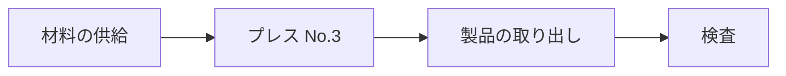

<!-- synthetic: 合成の文書。性能の値・取引の条件は架空。 -->

## 目的と範囲

第 3 ラインのプレス機 No.3 を更新し、サイクルタイムを理論値に近づけ、安全の措置を設備の側で満たす。
範囲は、本体・金型の交換の装置・安全の装置・据付と試運転である。

## 要求事項

::: req REQ-L3-010 priority=must verify=test
理論サイクルタイムは 2.4 秒以下とする。
受入: 連続 100 ショットの平均を計測する。
:::

::: req REQ-L3-011 priority=should verify=demonstration
金型の交換は 10 分以内に終えられること（「段取りの時間」には、工具の準備を含めない。）。
:::

::: req REQ-L3-012 priority=must verify=test
ガードが開いたら、スライドは 0.2 秒以内に停止すること（[[RA-2026-014#C-01a]] の措置）。
:::

::: req REQ-L3-013 priority=could verify=inspection status=deprecated
（旧）操作盤は日本語と英語の 2 言語とする。
[[URS-L3-001#REQ-L3-014]] に置き換えた。
:::

::: req REQ-L3-014 priority=must verify=inspection
操作盤の表示は、日本語・英語・インドネシア語を切り替えられること。
:::

## 決めるべき項目

::: decision D-01 state=decided required=true owner="設備の担当"
検収の場所: 据付の後、工場で行う（メーカーの工場での立会いは行わない）。
:::

::: decision D-02 state=open required=true owner=購買
支払いの条件（前払いの割合）。
:::

::: decision D-03 state=na required=false
海外の規格への適合: 対象外（国内の工場だけで使うため）。
:::

## 検収の条件

::: check K-01 covers=REQ-L3-010
連続 100 ショットのサイクルタイムの平均が 2.4 秒以下であることを、工場の計測で確かめる。
:::

::: check K-02 covers=REQ-L3-012
ガードを開いてからの停止時間を 10 回計測し、すべて 0.2 秒以内であること。
:::

::: check K-03 covers=REQ-L3-014
操作盤の表示を 3 つの言語に切り替え、すべての画面で文字が欠けないことを目で確かめる。
:::
